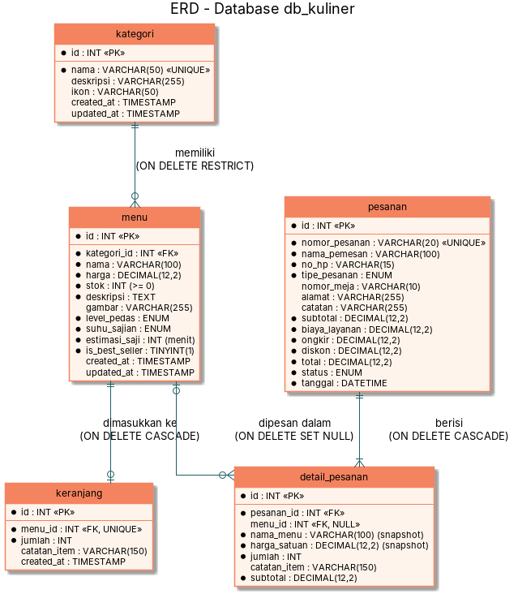

# ERD & Normalisasi Database `db_kuliner`

Sumber diagram: [`diagram/erd.puml`](diagram/erd.puml). Skema lengkap: [`../database/db_kuliner.sql`](../database/db_kuliner.sql).

## 1. Relasi & Kardinalitas
| Relasi | Kardinalitas | Implementasi | Aturan FK |
|---|---|---|---|
| kategori — menu | 1 : N (satu kategori punya 0..N menu, satu menu tepat 1 kategori) | `menu.kategori_id → kategori.id` | `ON DELETE RESTRICT` (kategori berisi menu tidak bisa dihapus) |
| menu — keranjang | 1 : 0..1 (satu menu maksimal 1 baris keranjang) | `keranjang.menu_id → menu.id`, `UNIQUE(menu_id)` | `ON DELETE CASCADE` |
| pesanan — detail_pesanan | 1 : N (minimal 1 item) | `detail_pesanan.pesanan_id → pesanan.id` | `ON DELETE CASCADE` |
| menu — detail_pesanan | 1 : N (opsional) | `detail_pesanan.menu_id → menu.id` (boleh NULL) | `ON DELETE SET NULL` (riwayat tetap utuh) |

## 2. Proses Normalisasi
**Bentuk tidak normal (UNF)** — jika nota pesanan dicatat apa adanya dalam satu tabel:

| nomor_pesanan | nama_pemesan | tanggal | menu (berulang) | kategori | harga | jumlah | total |
|---|---|---|---|---|---|---|---|
| INV-20261010-001 | Dimas | 10/10/2026 | Chicken Katsu, Kopi Susu, Dimsum | Makanan Utama, Minuman, Snack | 35000, 20000, 25000 | 2, 3, 1 | 149500 |

Masalah: kolom berisi banyak nilai (*repeating group*), data menu & kategori berulang di setiap nota.

**1NF** — setiap sel atomik, repeating group dipecah menjadi baris per item:

| nomor_pesanan | nama_pemesan | tanggal | nama_menu | nama_kategori | harga | jumlah | subtotal |
|---|---|---|---|---|---|---|---|
| INV-20261010-001 | Dimas | … | Chicken Katsu | Makanan Utama | 35000 | 2 | 70000 |
| INV-20261010-001 | Dimas | … | Kopi Susu | Minuman | 20000 | 3 | 60000 |

Kunci komposit: (`nomor_pesanan`, `nama_menu`).

**2NF** — hilangkan ketergantungan parsial terhadap sebagian kunci komposit:
- `nama_pemesan, no_hp, tipe_pesanan, tanggal, total, status, …` hanya bergantung pada `nomor_pesanan` → tabel **pesanan**.
- `harga, deskripsi, stok, kategori, …` hanya bergantung pada menu → tabel **menu**.
- `jumlah, catatan_item, subtotal` bergantung pada (pesanan, menu) → tabel **detail_pesanan**.

**3NF** — hilangkan ketergantungan transitif:
- Pada `menu`, `nama_kategori` & `deskripsi kategori` bergantung pada kategori, bukan pada menu (menu → kategori → nama_kategori) → dipisah menjadi tabel **kategori**, dan `menu` hanya menyimpan `kategori_id` (FK). Nama kategori ditampilkan lewat `JOIN`.
- Keranjang belanja (data sementara sebelum checkout) disimpan di tabel **keranjang** terpisah dan hanya menyimpan `menu_id`, `jumlah`, `catatan_item`; harga & nama selalu diambil dari `menu` lewat JOIN.

Hasil akhir: **kategori, menu, keranjang, pesanan, detail_pesanan** — setiap atribut non-kunci bergantung penuh pada kunci primernya dan tidak ada ketergantungan transitif.

## 3. Catatan Desain (denormalisasi yang disengaja)
- `detail_pesanan.nama_menu` dan `harga_satuan` adalah **snapshot** saat transaksi. Ini bukan redundansi yang melanggar 3NF secara fungsional, karena nilainya adalah fakta historis transaksi (harga saat dibeli) yang memang berbeda dari harga menu saat ini. Dengan begitu riwayat & struk tidak berubah ketika menu diedit atau dihapus.
- `pesanan.subtotal, biaya_layanan, ongkir, diskon, total` disimpan (bukan dihitung ulang) untuk alasan yang sama: aturan biaya bisa berubah di masa depan, tetapi nilai transaksi lama harus tetap.
