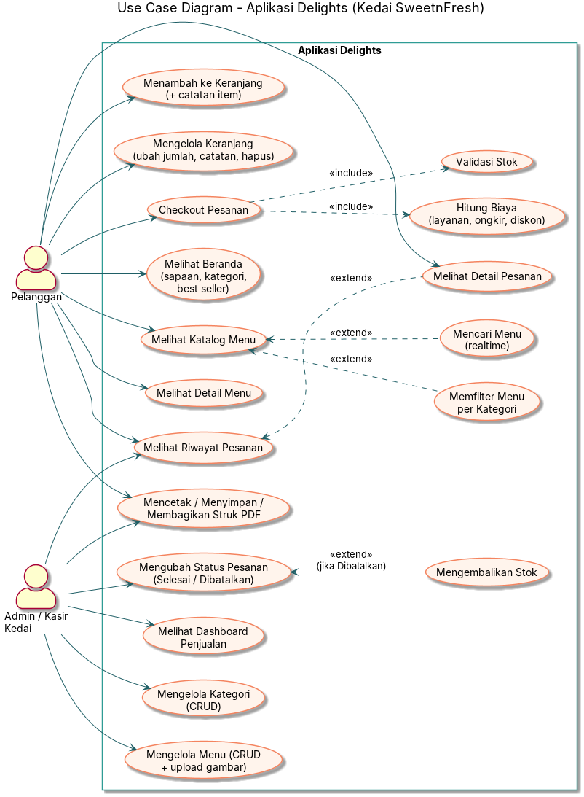
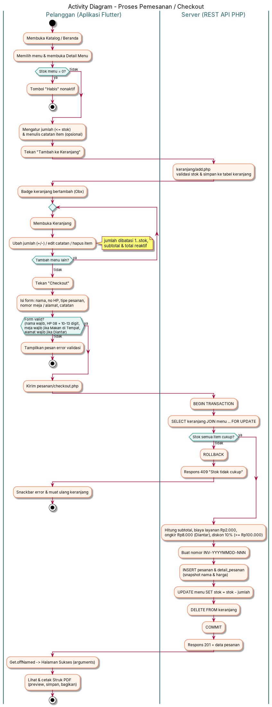

# Analisis Kebutuhan Sistem — Aplikasi **Delights** (Kedai SweetnFresh)

| | |
|---|---|
| Nama aplikasi | Delights — *Your Personal Food Order App* |
| Kedai | SweetnFresh |
| Pembuat | Aulia Sapitriyani Limbong — NIRM 2023020326 — Kelas 7SIA6 |
| Platform | Android (Flutter 3.41.6 + GetX), REST API PHP native, MySQL/MariaDB (XAMPP) |

## 1. Deskripsi Singkat
Delights adalah aplikasi katalog dan pemesanan makanan & minuman untuk kedai **SweetnFresh**.
Pelanggan dapat melihat menu, mencari & memfilter, menambah menu ke keranjang beserta catatan,
lalu checkout (makan di tempat, bawa pulang, atau diantar). Admin/kasir mengelola kategori,
menu, status pesanan, dan memantau penjualan lewat dashboard. Setiap pesanan dapat dicetak
sebagai struk PDF.

## 2. Aktor
| Aktor | Deskripsi |
|---|---|
| Pelanggan | Melihat menu, mengelola keranjang, checkout, melihat riwayat & struk pesanan. |
| Admin / Kasir Kedai | Mengelola kategori & menu, mengubah status pesanan, melihat dashboard penjualan. |

## 3. Kebutuhan Fungsional
| Kode | Kebutuhan | Aktor |
|---|---|---|
| F-01 | Sistem menampilkan beranda berisi sapaan sesuai waktu (pagi/siang/sore/malam), daftar kategori, menu best seller, dan menu terbaru. | Pelanggan |
| F-02 | Sistem menampilkan katalog menu dalam bentuk grid (GridView). | Pelanggan |
| F-03 | Sistem menyediakan pencarian menu berdasarkan nama secara realtime (debounce 400 ms). | Pelanggan |
| F-04 | Sistem menyediakan filter kategori (ChoiceChip: Semua, Makanan Utama, Minuman, Snack, Dessert) yang dapat dikombinasikan dengan pencarian. | Pelanggan |
| F-05 | Sistem menampilkan detail menu: gambar, nama, kategori, harga, stok, level pedas (badge berwarna), suhu sajian, estimasi saji, deskripsi. | Pelanggan |
| F-06 | Pelanggan dapat memilih jumlah dan menulis catatan per item lalu menambahkannya ke keranjang; tombol nonaktif bertuliskan "Habis" jika stok 0. | Pelanggan |
| F-07 | Pelanggan dapat mengubah jumlah item (+/−) dengan batas 1 s.d. stok, mengedit catatan, dan menghapus item keranjang. | Pelanggan |
| F-08 | Sistem menghitung subtotal per item dan total keranjang secara otomatis serta menampilkan badge jumlah item di AppBar & bottom navigation. | Pelanggan |
| F-09 | Pelanggan dapat checkout dengan mengisi nama, nomor HP, tipe pesanan, nomor meja (wajib untuk Makan di Tempat), alamat (wajib untuk Diantar), dan catatan. | Pelanggan |
| F-10 | Sistem menghitung biaya layanan Rp2.000, ongkir Rp8.000 (Diantar), diskon 10% (subtotal ≥ Rp100.000) dan total bayar. | Sistem |
| F-11 | Sistem membuat nomor pesanan otomatis `INV-YYYYMMDD-NNN` (NNN reset setiap hari), menyimpan pesanan & detail, dan mengurangi stok dalam satu transaksi database. | Sistem |
| F-12 | Sistem menampilkan riwayat pesanan urut terbaru dengan warna status berbeda dan filter status. | Pelanggan, Admin |
| F-13 | Sistem menampilkan detail pesanan (item + catatan, rincian biaya, info pemesan, tipe & meja/alamat). | Pelanggan, Admin |
| F-14 | Admin dapat mengubah status pesanan Diproses → Selesai/Dibatalkan (dengan konfirmasi); pembatalan mengembalikan stok; status final tidak dapat diubah lagi. | Admin |
| F-15 | Sistem membuat struk PDF (logo, nama kedai, nomor pesanan, tanggal, tipe, item, rincian biaya, total) dengan preview, simpan ke perangkat, dan bagikan. | Pelanggan, Admin |
| F-16 | Admin dapat menambah, melihat, mengubah, dan menghapus kategori; nama wajib diisi dan tidak boleh duplikat (cek di aplikasi & server). | Admin |
| F-17 | Sistem menolak penghapusan kategori yang masih memiliki menu dan menampilkan pesan yang jelas. | Admin |
| F-18 | Admin dapat menambah, melihat, mengubah, dan menghapus menu (nama, kategori, harga, stok, deskripsi, gambar dari galeri, level pedas, suhu sajian, estimasi saji, best seller). | Admin |
| F-19 | Daftar menu menampilkan nama kategori hasil query JOIN. | Admin |
| F-20 | Sistem menampilkan dashboard: total pesanan, total pendapatan (pesanan Selesai), menu terlaris, BarChart 5 menu terlaris, LineChart pendapatan 7 hari, PieChart penjualan per kategori. | Admin |

## 4. Kebutuhan Non-Fungsional
| Kode | Kategori | Kebutuhan |
|---|---|---|
| NF-01 | Performa | Setiap request API memiliki batas waktu 15 detik (upload 30 detik); pencarian memakai debounce 400 ms agar tidak membanjiri server. Daftar memakai builder (lazy) agar ringan. |
| NF-02 | Usability | Antarmuka berbahasa Indonesia, warna identitas konsisten (coral `#F4845F`, mint `#2F9C95`, krem `#FFF4EC`), loading indicator di setiap request, pesan sukses/gagal lewat `Get.snackbar`, konfirmasi sebelum aksi destruktif. |
| NF-03 | Reliabilitas | Checkout dan pembatalan pesanan berjalan dalam transaksi DB (`beginTransaction`, `SELECT … FOR UPDATE`, `commit`/`rollBack`) sehingga stok tidak pernah negatif atau tidak konsisten. |
| NF-04 | Keamanan | Semua query memakai PDO prepared statement (anti SQL injection); input divalidasi di aplikasi **dan** server; upload gambar dibatasi JPG/PNG/WEBP maks 2 MB dan dicek dengan `getimagesize`; nama file upload dibuat acak. |
| NF-05 | Integritas data | Database ternormalisasi (3NF), FK dengan aturan RESTRICT/CASCADE/SET NULL, UNIQUE pada nama kategori, nomor pesanan, dan menu di keranjang; snapshot nama & harga di `detail_pesanan`. |
| NF-06 | Kompatibilitas | Android 5.0 (API 21) ke atas; dibangun dengan Flutter 3.41.6 / Dart 3.11.4, AGP 8.11.1, Kotlin 2.2.20, Gradle 8.14; HTTP lokal diizinkan di APK release lewat `network_security_config.xml`. |
| NF-07 | Error handling | Server mati/timeout, respons kosong/bukan JSON, stok habis, dan error validasi ditangani dengan pesan yang jelas dan tombol "Coba Lagi". |
| NF-08 | Maintainability | Arsitektur GetX terpisah (models, controllers, views, routes, data/services, widgets, bindings, theme, utils); base URL API terpusat di satu file dan dapat diubah lewat `--dart-define`. |
| NF-09 | Portabilitas data | Respons API seragam `{ success, message, data }` dengan HTTP status code yang benar (200/201/404/405/409/422/500). |

## 5. Diagram
- Use Case Diagram: [`diagram/use_case.puml`](diagram/use_case.puml) → 
- Activity Diagram Checkout: [`diagram/activity_checkout.puml`](diagram/activity_checkout.puml) → 
- ERD: [`diagram/erd.puml`](diagram/erd.puml) →  — penjelasan normalisasi di [`erd_normalisasi.md`](erd_normalisasi.md)

Render ulang PNG (opsional): `plantuml -tpng docs/diagram/*.puml` atau tempel isi `.puml` ke https://www.plantuml.com/plantuml.
